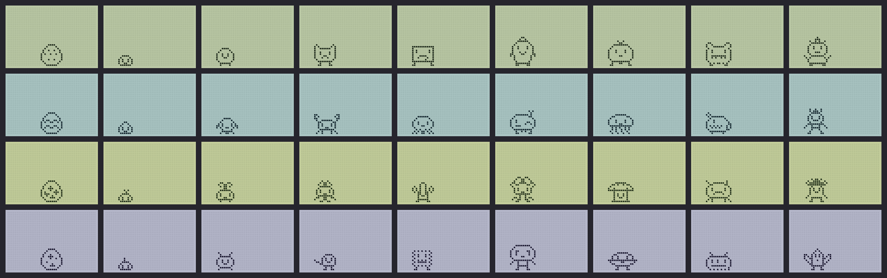
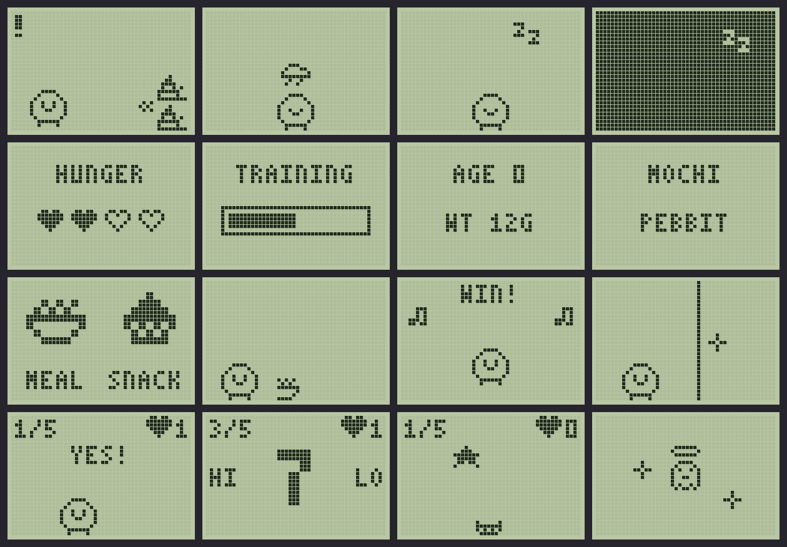

# MyPet

An original retro virtual pet for Android, in the classic pocket-pet genre: hatch an egg,
keep it fed, happy, clean and well-behaved, and the care you give decides what it grows into.
An HTML5 version is planned; the game rules live in a plain Kotlin module so they can be shared.

All names, characters, pixel art and icons in this project are original. MyPet copies no
trademarks, character designs, sprites, sounds, device shapes or menu layouts from any existing
product. Only the general care-loop genre mechanics are reused.

## Editions

Pick one of four "device editions" when you hatch an egg. Each has its own growth line of nine
forms (egg, baby, child, two teens, three adults and one secret form) and slightly different rules.

| Edition | Feel | Rule differences |
|---|---|---|
| **Pebble** (classic) | Round pebble critters | Baseline rules, classic endings, Which Way? game |
| **Tide** (sea) | Sea critters | Stays full longer, gets bored faster, more droppings, Hi or Lo game |
| **Sprout** (garden) | Plant pets | Rarely sick, early bedtime, gentle endings (pet heads home), Star Catch game |
| **Nova** (space) | Star critters | Grows up twice as fast, shorter life, hungrier, all three games, bigger game rewards |

## Default rules

| Setting | Default |
|---|---|
| Time speed | **Real time (1x)**: one pet day is one real day. 2x and 4x in Settings. A Pause switch freezes time. |
| Growth | Egg 5 min, baby 1 hour, child 1 day, teen 3 days, then adult (Nova: half the child and teen time). |
| Forms | 9 per edition, 36 in total. Child care picks the teen; teen care and discipline pick the adult. |
| Secret form | A best-branch adult kept at 100% discipline with no care mistakes for 2 more days. |
| Lifespan | Best adult ~16 days, okay ~12, rough ~8, secret ~22. Each care mistake as an adult takes off half a day. |
| Endings | **Pets can pass away** in Pebble, Tide and Nova (old age, 12 awake hours starving, or 12 awake hours sick). In Sprout they head home instead. |
| Care mistakes | Any call (hungry, bored, sick, light left on at bedtime) unanswered for 15 game minutes. |
| Discipline | The pet sometimes calls or refuses food for no reason. Scold it then to raise discipline; scolding at other times makes it sad. |
| Food | Meal: +1 hunger heart, +1 weight. Snack: +1 happy heart, +2 weight; too many snacks cause a tummy ache. |
| Sickness | From droppings left 6 hours, too many snacks, being overweight, or bad luck. 1-2 doses of medicine cure it. |
| Sleep | Each edition has a bedtime. Turn the light off within 15 minutes. Nothing drains while asleep. |

## How it's built

- `core/`: the rules engine (`PetGame`), editions and sprites (`Editions`), mini-games and the
  save format. Pure Kotlin with unit tests. The simulation is deterministic, so the app can work
  out exactly when the pet will next call and set a single alarm for a notification.
- `app/`: the Android app in Kotlin and Jetpack Compose. A 48x32 dot-matrix LCD is drawn on a
  Canvas, inside a handheld-style shell tinted per edition.

## Building

Open the project in Android Studio (Ladybug or newer) and run the `app` configuration, or:

```sh
./gradlew :core:test          # rule tests
./gradlew :app:assembleDebug  # APK at app/build/outputs/apk/debug/app-debug.apk
```

On a machine without the Android SDK, `MYPET_CORE_ONLY=1 ./gradlew :core:test` builds and tests
just the rules. Every pull request is also built by GitHub Actions, which uploads the debug APK
as a downloadable artifact.

In the app, **Settings → Tester tools → Skip ahead 1 hour** lets you fast-forward while testing.

## Screens

All 36 forms across the four editions:



A few LCD scenes (hungry call, sick, asleep, lights off, status pages, feeding, games, ending):


